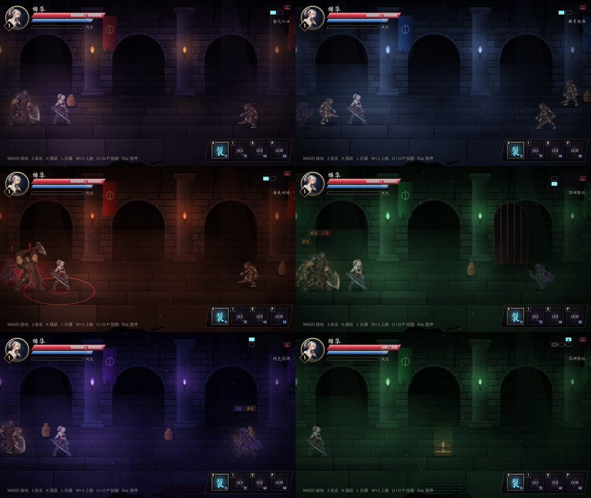
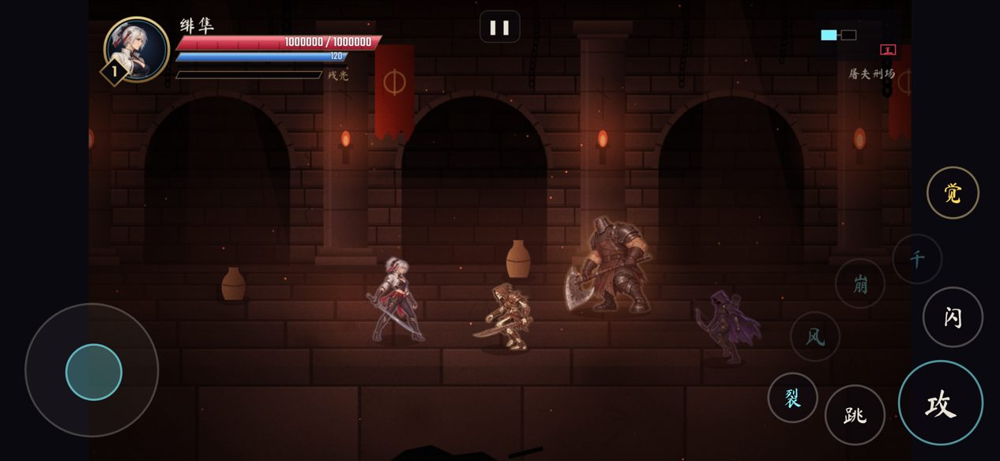

# 素材优化需求 v4：环境与角色

这份文档**只提需求和提示词**。素材生成好以后，我再接入游戏（接入方式见每一节的「游戏里怎么接」）。

---

## 一、现状审查：哪里最不专业



从左上到右下依次是：第 1～5 关的开场房间，最后一张是第 4 关的宝箱房。

| # | 问题 | 严重程度 | 依据 |
|---|---|---|---|
| 1 | **五关是同一个房间换颜色。** 拱门、柱子、火把、地砖、旗帜的位置和形状完全一样，只是色调不同（紫 / 蓝 / 红 / 绿 / 靛）。玩家打到第三关就会觉得「一直在同一个地方」 | ★★★★★ | `src/scenery.js`：所有主题共用 `makeWall`、`makePillars`、`makeFloorRow`，只换颜色表 |
| 2 | **画风打架。** 角色是高清手绘、有材质和体积；背景是程序生成的平涂色块和规则砖缝，一眼看出是两套东西。这是「像独立小游戏而不是成品」的最大来源 | ★★★★★ | 截图里角色和背景的细节密度差很多 |
| 3 | **首领是放大的杂兵。** 骸骨统领 = 腐骨兵 ×1.5，夜鸦 = 影弓手 ×1.35，**铁颚和祭坛守护者都是铁甲屠夫**，只是颜色不同。首领招式（跳劈、冲锋、读条）借用杂兵的帧，冲锋用快速播放的走路帧代替 | ★★★★ | `src/enemy_sprites.js` 的 `BOSS_FRAMES` |
| 4 | **主角技能没有专门的动作。** 回风斩（旋转斩）是两帧普攻来回切；崩山击用施法 + 蓄力；弹刀没有弹刀姿势；空中冲刺停在闪避的一帧；千刃和必杀是几种出刀帧轮换。这些都是玩家最常看到、最需要「帅」的瞬间 | ★★★★ | `src/sprite.js` 的 `heroFrame` |
| 5 | **道具是程序画的。** 陶罐、宝箱、泉水、门都是简单色块，和手绘角色站在一起很突兀 | ★★★ | 截图最后一张的宝箱 |
| 6 | **手机上 90px 的可读性：基本合格。** 主角、腐骨兵、屠夫、弓手在手机上都分得清（见下图）。腐骨兵靠引擎提亮 30%，弓手靠斗篷边缘的亮紫色，暂时够用 | ★ |  |
| 7 | **图集内存约 64MB**（解码后：主角 32MB、腐骨兵 12MB、屠夫 10MB、弓手 10MB），另有最多约 36MB 的染色缓存。现在还能接受，但再加首领和环境就会超过低端手机的安全线 | ★★ | 见第五节的接入方案 |

**结论**：最拖观感的是**环境**（每时每刻都在屏幕上，而且五关一个样），其次是**首领**和**主角技能动作**。杂兵 P0 已经合格，这一批不重做。

---

## 二、这一批要做的素材（按观感提升排序）

| 顺序 | 素材包 | 为什么值得做 | 观感提升 | 包体 / 手机内存 |
|---|---|---|---|---|
| 1 | **ENV-1 地宫建筑套件**（五关共用） | 背景每一帧都在屏幕上，换成手绘后画风统一，提升最大 | 整个画面从「程序拼的」变成「美术画的」 | 下载约 1.2MB；内存桌面约 22MB / 手机约 6MB |
| 2 | **ENV-2 五关远景**（每关一张） | 解决「五关一个样」：每关有自己的地标和气氛 | 每关有辨识度，推进有「到了新地方」的感觉 | 每张约 400KB，只下载和载入当前关的一张；内存桌面约 6MB / 手机约 1.5MB |
| 3 | **BOSS-1 骸骨统领**（第 1 关首领） | 每个玩家遇到的第一个首领，第一印象 | 首领战有压迫感，招式有专门的动作 | 约 700KB；只在第 1 关载入；内存桌面约 19MB / 手机约 11MB |
| 4 | **HERO-3 绯隼技能补完** | 回风斩、崩山击、弹刀、空中冲刺、千刃都是高频、高光时刻 | 技能从「几帧轮换」变成真正的招式 | 约 300KB；主角图集桌面 32 → 38MB，手机改用半尺寸后反而降到约 21MB |
| 5 | **ENV-3 道具与机关** | 陶罐、宝箱、泉水、门、火把台和角色同一画风 | 场景里的互动物件不再突兀 | 约 400KB；内存桌面约 6MB / 手机约 3MB |
| 6 | **BOSS-2 祭坛守护者**（第 4 关首领） | 现在和铁颚是同一个模型，最明显的复用 | 第 3、4 关首领不再撞脸 | 约 650KB；只在第 4 关载入；内存桌面约 15MB / 手机约 8MB |

**暂不做**（下一批再说）：
- 杂兵重做：P0 已经合格，走路问题已经用帧偏移修过
- 夜鸦、铁颚专属素材：它们和对应杂兵的体型、武器还算匹配，优先级低于撞脸的祭坛守护者
- 残影：用主角的暗色版本，本来就是设计
- 杂兵 P1 动作：首领有专属素材以后，杂兵的 P1 收益很小

**发布位置**：GitHub Release **`assets-v4`**。文件名：`env_kit_v1.zip`、`env_backdrops_v1.zip`、`boss_bone_lord_v1.zip`、`feisun_skills_v3.zip`、`env_props_v1.zip`、`boss_altar_warden_v1.zip`。可以按顺序分批上传，每传一个告诉我一声。

---

## 三、角色类：通用规格（和绯隼、敌人包完全一致）

- 每帧 **512×512** 透明 PNG（直通 alpha），**朝右**，锚点 **(220, 448)** = 脚底中心
- 站立高度：主角约 360px；首领约 360px（引擎会放大到首领尺寸；不要画得比这更大，否则举过头顶的武器会被裁掉）
- **原地动画**：骨盆的水平位置每帧都在 x≈220 附近（±6px），位移、跳跃高度、击退都由引擎做；空中姿势以身体最低点落在 y=448
- **干净帧**：没有刀光、拖影、发光、速度线、火花、血、尘土、地面阴影；眼睛的光只能是小亮点
- **帧数只用 4 或 8**：4 帧排 4×1（2048×512），8 帧排 4×2（2048×1024）
- **倒地最后一帧 = 起身第一帧**（同一张图逐字节复制）
- **同一角色跨帧一致**：每套先生成一张全身身份参考图，之后所有动作都拿它当参考
- **走路**：提示词里加 `the torso and head keep the same lean and the same horizontal position in every frame; only the legs, arms and weapon move; the head bobs smoothly — lowest on the contact frames (0 and 4), highest on the passing frames (2 and 6)`
- **90px 暗底检查**：每个动作缩到站立高度 90px，放在 `#1a1420` 底色上看，预警帧要一眼看出是什么招；看不清剪影就重做
- **文件结构**：
  ```
  包名/
    README_zh.md
    animations.json           # 格式同 feisun.spritepack.v1：frame_names、duration_ms、
                              # suggested_contact_frame_indices、suggested_windup_frame_indices
    artwork/identity_fullbody.png   # 1024×1536 身份参考图
    artwork/avatar_128.png          # 128×128 头像（首领血条用）
    frames/动作名/动作名_00.png ...
    sheets/动作名.png
    docs/onion/动作名.png            # 叠帧图（检查对齐）
    docs/visibility_90px_dark.png    # 90px 暗底剪影检查
  ```
- 帧号**从 0 开始**（表格和 JSON 一致）；英文提示词里从 1 开始

### 角色提示词模板

身份参考图：

```
Use case: stylized-concept. Asset type: character identity reference for a 2D side-scrolling action game.
Single full-body character, standing in a ready stance, three-quarter side view FACING RIGHT, entire body visible
with generous margin. Crisp high-quality hand-drawn anime game art with consistent controlled cel shading, dark
fantasy underground setting, matching a silver-haired anime swordswoman hero from the same game. Subtle cool rim
light along the back edge of the silhouette. Real alpha transparency, no backdrop, no ground shadow, no text.
Portrait canvas 1024 by 1536.
CHARACTER: 【身份描述】
```

动作表（把身份参考图作为参考图片输入）：

```
Use case: stylized-concept. Asset type: production sprite animation sheet for a 2D side-scrolling action game.
The reference image is the IDENTITY / COSTUME reference, not the layout. Draw exactly the SAME character:
【身份描述】
Preserve the face, body proportions, costume and weapon exactly, in crisp high-quality hand-drawn anime game art
with consistent controlled cel shading. Subtle cool rim light along the back edge of the silhouette.
OUTPUT LAYOUT IS CRITICAL: 【帧数布局】 Reading order left to right, top row then bottom row. All cells identical
camera and identical character scale: standing figure height approximately 360 px. Facing RIGHT throughout,
side / three-quarter side camera.
IN-PLACE ANIMATION: feet ground line at y=448 inside EACH tile (for airborne poses the lowest point of the body is
at y=448); the pelvis stays near x=220 inside each tile (within 6 px). The body may lean, crouch and twist, but
must not translate across the tile.
CLEAN FRAMES: NO slash effects, NO motion trails, NO glow, NO speed lines, NO sparks, NO blood, NO dust —
character and weapon only.
Real alpha transparency, no backdrop, no ground shadow, no grid, no borders, no text, no frame numbers.
ACTION: 【动作】
```

【帧数布局】
- 8 帧：`exactly EIGHT full-body sequential animation poses in a uniform FOUR-column TWO-row sprite sheet, landscape 2048 by 1024 pixels, each invisible tile 512 by 512.`
- 4 帧：`exactly FOUR full-body sequential animation poses in a single row of FOUR columns, landscape 2048 by 512 pixels, each invisible tile 512 by 512.`

---

## 四、角色素材包

### BOSS-1 骸骨统领 `boss_bone_lord_v1`（第 1 关首领）

**为什么**：每个玩家第一个遇到的首领。现在是腐骨兵放大 1.5 倍，体型和武器都撑不起「首领」。

**身份描述**：
```
a towering skeletal warlord, far more imposing than a common skeleton soldier: broad heavy bone frame, a rusted
iron crown fused onto the skull with small ember-red pinpoint eyes, heavy bone-and-iron pauldrons with spikes,
a tattered crimson-and-black war cape, ribs wrapped in dark chain mail, an enormous two-handed rusted cleaver
greatsword with a notched edge and a bone-wrapped hilt. Proud, upright, menacing posture — not hunched.
```
颜色以骨白、铁锈褐、暗红为主，**骨头要比腐骨兵亮**（腐骨兵在暗场景里偏暗）。

| 动作 ID | 帧数 | 预警帧 | 接触帧 | 游戏里的用途 | 【动作】描述 |
|---|---|---|---|---|---|
| `idle` | 4 | — | — | 待机 | `idle breathing loop: upright stance, greatsword resting on the shoulder, cape stirring; 4 frames looping seamlessly.` |
| `walk` | 8 | — | — | 移动 | `heavy deliberate walk loop in place, greatsword on the shoulder, cape swaying.` + 走路稳身句 |
| `hurt` | 4 | — | — | 破防后受击 | `hit reaction: 1 recoil, 2 head snapped back and torso bent, 3-4 recover.` |
| `air_hurt` | 4 | — | — | 破防后被打飞 | `launched by a heavy blow: body arched backward, limbs flung out, greatsword still gripped; rotating toward horizontal over 4 frames, lowest point at y=448.` |
| `down` | 4 | — | — | 倒地 | `falling: 1 back slams down, 2 bounce, 3-4 lying flat on the back, still (frames 3 and 4 identical).` |
| `getup` | 4 | — | — | 起身 | `1 lying on the back EXACTLY as the last down frame, 2 pushing up on the greatsword, 3 kneeling, 4 standing.` |
| `cleave` | 8 | 2 | 4 | 三连斩第 1、3 下 | `overhead cleave: 1-2 heaving the greatsword up behind the head; 3 WIND-UP HOLD, blade high overhead, body arched back; 4 brutal downward cleave; 5 blade buried low in front; 6-8 dragging it back up to the ready stance.` |
| `backhand` | 8 | 1 | 3 | 三连斩第 2 下 | `rising backhand sweep: 1-2 blade low and behind the body (2 is the WIND-UP HOLD); 3 wide upward diagonal sweep; 4 blade high after the follow-through; 5-8 recover.` |
| `leap_slam` | 8 | 2 | 5 | 跳劈 | `leaping slam: 1 deep crouch; 2 WIND-UP HOLD, coiled to leap, greatsword raised; 3-4 airborne, both hands overhead, knees tucked (lowest point at y=448); 5 landing and smashing the blade into the ground; 6 crouched, blade stuck; 7-8 wrench it out and rise.` |
| `charge` | 4 | — | — | 冲锋 | `charging run loop: body leaning far forward, shoulder lowered, greatsword dragged behind, cape streaming.` |
| `stunned` | 4 | — | — | 冲锋撞墙晕眩 | `dazed after crashing into a wall: staggering, crown askew, greatsword tip on the ground; 4 frames looping.` |
| `roar` | 4 | — | — | 进入新阶段、召唤 | `commanding roar: skull thrown back, jaw open, free arm sweeping wide, greatsword raised in the other hand; building to the peak.` |
| `channel` | 4 | — | — | 读条「亡骨号令」 | `channeling a forbidden command: greatsword planted point-down in front, both hands on the pommel, skull raised to the sky, cape lifting; subtle looping tremble over 4 frames.` |

合计 **68 帧**。

### BOSS-2 祭坛守护者 `boss_altar_warden_v1`（第 4 关首领）

**为什么**：现在和第 3 关首领铁颚是同一个铁甲屠夫模型，换了个绿色。

**身份描述**：
```
an ancient altar guardian, a giant hunched temple warden of bronze and stone: a massive frame in layered
verdigris-green bronze armor plates carved with spiral rune grooves, a hooded robe of moss-dark cloth hanging in
heavy folds, a pale jade ceramic mask with narrow eye slits and two tiny pale-green pinpoints of light, long
censer chains hanging from the belt, wielding a huge bronze halberd with a crescent axe blade. Slow, monumental,
priest-like silhouette — clearly different from a butcher or a skeleton.
```
颜色以铜绿、苔绿、玉白为主，铜甲边缘要有明显的高光。

| 动作 ID | 帧数 | 预警帧 | 接触帧 | 用途 | 【动作】描述 |
|---|---|---|---|---|---|
| `idle` | 4 | — | — | 待机 | `idle loop: standing tall, halberd held upright beside the body, censer chains swaying.` |
| `walk` | 8 | — | — | 移动 | `slow heavy walk loop in place, halberd planted like a staff each step.` + 走路稳身句 |
| `hurt` / `air_hurt` / `down` / `getup` | 4 / 4 / 4 / 4 | — | — | 同 BOSS-1 | 沿用 BOSS-1 的描述，换成 halberd |
| `slam` | 8 | 3 | 4 | 重砸 | `overhead halberd smash: 1-3 heaving the halberd high; 4 WIND-UP HOLD, axe blade at its highest, body leaning back; 5 smashing it into the ground; 6 crouched, blade buried; 7-8 pulling free.` |
| `stomp` | 4 | 1 | 2 | 震地波 | `ritual stomp: 1 lifting one huge foot with the halberd raised; 2 WIND-UP HOLD, knee at its highest; 3 stomping down, halberd butt striking the floor; 4 recover.` |
| `invoke` | 4 | 1 | 3 | 天降（召唤落石） | `invoking the sky: 1 halberd raised overhead in both hands; 2 WIND-UP HOLD, mask tilted up; 3 thrusting the halberd skyward; 4 lowering it.` |
| `charge` | 4 | — | — | 冲锋 | `lumbering charge loop: halberd leveled forward like a spear, body leaning in.` |
| `stunned` | 4 | — | — | 撞墙晕眩 | `dazed: swaying, mask cracked askew, halberd sagging.` |
| `roar` | 4 | — | — | 新阶段、召唤 | `wrathful proclamation: arms spread, halberd raised high, robe flaring.` |
| `channel` | 4 | — | — | 读条「祭坛炎狱」 | `kneeling channel: one knee down, halberd held horizontally above the head in both hands, mask raised; looping tremble.` |

合计 **56 帧**。

### HERO-3 绯隼技能补完 `feisun_skills_v3`

**为什么**：技能、弹刀、空中冲刺是战斗里最高频的高光时刻，现在都是借普攻的帧凑出来的。

**身份**：沿用 v2 素材包的 `artwork/hero_fullbody.png` 作为参考图，身份描述照抄 `docs/ART_FEISUN.md` 第五节的模板。**只交付下面 5 组新动作**，其他动作不重做；`animations.json` 只写这 5 组，我会合并进现有图集。

| 动作 ID | 帧数 | 预警帧 | 接触帧 | 用途 | 【动作】描述 |
|---|---|---|---|---|---|
| `whirl` | 8 | — | 2, 6 | 回风斩（旋转连斩，可移动） | `spinning whirlwind slash loop, in place: the swordswoman pivots on the balls of her feet through one full 360-degree turn over 8 frames, sword held out at arm's length at waist height so the blade sweeps all the way around her body; ponytail and sash tails swing outward with the spin; frame 8 flows seamlessly back into frame 1.` |
| `parry` | 4 | — | 1 | 弹刀 | `parry deflection: 1 snapping the sword up into a guard in front of the body; 2 the instant of the clash, blade angled to deflect, body braced, sharp eyes; 3 slight recoil from the impact; 4 back to a ready stance with the sword forward.` |
| `air_dash` | 4 | — | — | 空中冲刺 | `mid-air forward dash: body stretched horizontally forward, sword held back along the body, legs trailing straight behind, ponytail streaming; 4 frames of a tight flutter loop. Lowest point of the body at y=448.` |
| `quake` | 8 | 3 | 4 | 崩山击（蓄力后震地） | `earth-shattering plunge strike: 1-2 gathering power, sword raised high in both hands, knees bent; 3 WIND-UP HOLD, leaping up with the sword reversed, point down (lowest point at y=448); 4 driving the sword point into the ground in a deep crouch; 5 holding the impact; 6-8 pulling the sword free and rising.` |
| `dash_slash` | 4 | — | 1 | 千刃·残光、必杀里的瞬身斩 | `blink dash slash: 1 low forward lunge, sword drawn back at the hip; 2 the cut — fully extended horizontal slash, body almost horizontal; 3 follow-through, sword behind; 4 sliding stop in a low ready stance.` |

合计 **28 帧**。

---

## 五、环境类：规格（新定）

### 游戏里的空间关系

- 逻辑分辨率 **960×540**；桌面最高按 2 倍渲染（1920×1080），所以**环境素材按 2 倍画**（以下尺寸都是 2 倍尺寸）
- 地面最远处（后墙脚）在屏幕 **y=636**（逻辑 318），可走的地面一直到屏幕底部 y=1080
- 镜头：**正侧面、平视略微俯视**（约 10°），没有透视消失点，所有水平线保持水平
- 房间宽度 1920～2800（逻辑 960～1400），镜头横向卷动

### 图层（从远到近）

| 图层 | 视差 | 尺寸（2 倍） | 内容 | 透明 | 谁画 |
|---|---|---|---|---|---|
| L0 远景 | 0.3 | 2048×720，**横向无缝** | 每关的地标：远处的大厅、天空、深渊……从后墙的拱门 / 破洞里看到 | 不透明 | ENV-2，每关一张 |
| L1 后墙 | 0.9 | 2048×720，**横向无缝** | 墙面、拱门、柱子、壁龛；拱门和破洞处**透明**，露出 L0 | 有透明 | ENV-1，五关共用 |
| L2 地面 | 1.0（引擎分行做透视） | 1024×444，**横向无缝** | 石板地面，靠近镜头的石板略大 | 不透明 | ENV-1 |
| L3 地面贴花 | 1.0 | 每张不超过 512×256 | 裂缝、积水、碎骨、血迹、符文圈、苔藓 | 透明 | ENV-1（共用）+ ENV-2（每关 2 张专属） |
| L4 前景 | 1.35 | 每张不超过 512×1080 | 垂下的锁链、断柱边缘、碎石堆、蛛网，**近乎剪影** | 透明 | ENV-1 |
| 道具 | 1.0 | 见 ENV-3 | 陶罐、宝箱、泉水、门、火把台、旗帜 | 透明 | ENV-3 |

### 画面要求（所有环境图）

- **画风**：与角色一致的高清手绘、受控色块阴影；石材有真实的材质（风化、裂纹、苔藓），**不要规则的网格砖缝**
- **中性光、低对比**：环境的整体亮度要明显低于角色。具体：后墙和远景的平均亮度在 20%～35%，最亮的地方不超过 60%。角色永远是画面里最亮、对比最强的东西
- **不要画光源**：不要点亮的火把、蜡烛、窗户光。火光、光柱、雾气都由引擎实时画（这样才能动、才能照亮角色）。可以画熄灭的火把台、烛台
- **饱和度低**：用接近灰的石色画。每关的色调（紫 / 蓝 / 红 / 绿 / 靛）由引擎统一调色，这样五关可以共用一套建筑
- **角色站位带要「安静」**：屏幕 y=500～980（人物所在的高度）不要放高对比的细碎图案，避免和角色抢
- **无缝**：L0、L1、L2 左右边缘必须能接上。做法：最左 128px 和最右 128px 画同一段内容；交付前把两张并排拼在一起检查接缝
- **透明**：L1 拱门里、L3、L4、道具都要真实透明。如果生成工具做不了透明，就把要透明的区域填成**纯品红 #FF00FF**，我来抠
- **没有人物、没有文字、没有界面**

### 可读性检查（交付前必做）

把现有的绯隼、腐骨兵、铁甲屠夫、影弓手（各取 `idle_00`）缩到 **站立 90px**，贴在 L0 + L1 + L2 合成的画面上（地面 y=900 附近），确认四个角色的剪影都清楚。看不清就降低背景亮度或对比，而不是提亮角色。

### 文件结构

```
env_kit_v1/
  README_zh.md
  env.json                 # 图层清单，格式见下
  layers/wall_a.png        # L1 后墙，2048×720
  layers/wall_b.png        # L1 后墙的第二种（换拱门间距和细节，避免重复感）
  layers/floor.png         # L2 地面，1024×444
  decals/*.png             # L3 贴花
  foreground/*.png         # L4 前景
  docs/tile_check_*.png    # 两张并排的接缝检查
  docs/readability_90px.png
```

`env.json` 格式：
```json
{
  "schema": "afterglow.envpack.v1",
  "scale": 2,
  "ground_line_y": 636,
  "layers": [
    { "id": "wall_a", "file": "layers/wall_a.png", "role": "wall", "parallax": 0.9, "y": 0, "tile_x": true },
    { "id": "floor", "file": "layers/floor.png", "role": "floor", "parallax": 1.0, "y": 636, "tile_x": true }
  ],
  "decals": [ { "id": "crack_01", "file": "decals/crack_01.png", "anchor": [0.5, 0.5] } ],
  "foreground": [ { "id": "chain_01", "file": "foreground/chain_01.png", "anchor": [0.5, 0.0], "attach": "top" } ]
}
```
`anchor` 是图片内的锚点比例；`attach` 是前景件贴在屏幕顶部（`top`）还是底部（`bottom`）。

---

## 六、环境素材包

### ENV-1 地宫建筑套件 `env_kit_v1`（五关共用）

**提示词（L1 后墙）**：
```
Use case: game environment art. Asset type: seamlessly tileable background wall layer for a 2D side-scrolling
action game, landscape 2048 by 720 pixels.
Hand-painted dark fantasy underground architecture in crisp high-quality anime game art style with controlled
cel-like shading, matching hand-drawn anime characters. Strict side-on orthographic view, all horizontal lines
perfectly level, no vanishing point. A massive ancient stone wall of large weathered blocks (not a regular brick
grid), with two tall round arches and one collapsed breach opening into darkness, thick carved pillars between
them, a cracked cornice along the top, worn stone base meeting the floor along the very bottom edge.
Neutral desaturated grey-stone palette, low contrast, mid-dark values (average brightness about 25%, nothing
brighter than 60%). No lit torches, no candles, no glowing windows, no light beams — empty unlit iron torch
brackets only. No characters, no text.
The insides of the arches and the breach must be fully transparent (or pure magenta #FF00FF if transparency is
not possible). The leftmost 128 px and the rightmost 128 px must show the same continuous wall so the image tiles
seamlessly side by side.
```
`wall_b`：同一段提示词，把 `two tall round arches and one collapsed breach` 换成 `a row of three narrow pointed niches holding broken urns and a sealed stone doorway`。

**提示词（L2 地面）**：
```
Use case: game environment art. Asset type: seamlessly tileable floor strip for a 2D side-scrolling brawler,
1024 by 444 pixels.
The walkable stone floor of an ancient underground hall seen from a low side angle (about 10 degrees from
horizontal): large irregular flagstones, worn smooth in the middle, cracks and grit in the seams, a few shallow
puddles. Stones near the top edge (far) look slightly smaller and darker than stones near the bottom edge (near).
Neutral desaturated grey-stone palette, low contrast, mid-dark values, no strong patterns. No light sources, no
characters, no text. The left and right edges must tile seamlessly.
```

**提示词（L3 共用贴花，12 张，每张透明）**：
```
Use case: game environment art. Asset type: a set of 12 separate floor decals for a 2D side-scrolling brawler,
each on its own transparent tile, laid out in a 4 by 3 grid of 512 by 256 tiles (2048 by 768 total).
Seen at the same low side angle as a stone floor: 1 long crack, 2 branching crack, 3 shallow puddle, 4 scattered
small bones, 5 a broken skull and ribs, 6 dried dark stain, 7 moss patch, 8 rubble pebbles, 9 fallen torn banner
cloth, 10 rusty chain lying on the floor, 11 worn carved floor rune circle (not glowing), 12 shattered pottery.
Neutral desaturated palette, soft edges blending into the floor, transparent background, no glow, no text.
```

**提示词（L4 前景，8 件，每件透明）**：
```
Use case: game environment art. Asset type: a set of 8 separate foreground silhouette pieces for a 2D side-
scrolling game, each on its own transparent tile, 4 by 2 grid of 512 by 1080 tiles (2048 by 2160 total).
Very dark, almost black near-silhouettes with only a faint cool rim of light, as if very close to the camera and
out of focus: 1 long hanging chain from the top, 2 two hanging chains with a hook, 3 a broken pillar edge on the
left side, 4 a broken pillar edge on the right side, 5 a rubble heap at the bottom, 6 a cobweb in the top corner,
7 a heap of skulls at the bottom, 8 tangled roots hanging from the top. Transparent background, no glow, no text.
```

**游戏里怎么接**：替换 `src/scenery.js` 里程序生成的墙、柱子、地砖和前景；L1 的 `wall_a` / `wall_b` 按房间随机交替；五关共用，每关的色调用现有的 `THEMES` 颜色做整体调色（乘色 + 叠加），火把位置对齐素材里的空火把台。

### ENV-2 五关远景 `env_backdrops_v1`

每关一张 L0（2048×720，不透明，横向无缝）+ 两张专属贴花（512×256，透明）。

**提示词（每关替换【场景】）**：
```
Use case: game environment art. Asset type: seamlessly tileable far-background layer for a 2D side-scrolling
action game, landscape 2048 by 720 pixels. This layer is only visible through arches and breaches in a nearer wall,
so it should read as deep and distant.
Hand-painted dark fantasy in crisp high-quality anime game art style with controlled cel-like shading. Strict
side-on view, level horizon, strong atmospheric depth: far shapes fade into haze. Low contrast, dark values
(average brightness about 20%), desaturated except for one restrained accent color. No characters, no text, no lit
light sources (no burning torches, no glowing windows). The left and right 128 px must tile seamlessly.
SCENE: 【场景】
```

| 关卡 | 【场景】 | 专属贴花 |
|---|---|---|
| 第 1 关 墓穴入口 | `a vast catacomb ossuary: endless walls of niches filled with stacked skulls and bones, crumbling stairways descending into fog, thick hanging roots; accent color: faded dusty violet.` | 散落的头骨堆、倒下的墓碑 |
| 第 2 关 骸骨回廊 | `an endless colonnade receding into cold blue mist: rows of tall bone-encrusted columns, bone chandeliers hanging unlit, a long gallery of arches; accent color: cold steel blue.` | 碎骨吊灯残骸、冰冷积水 |
| 第 3 关 屠夫刑场 | `an open execution yard seen through a broken wall: wooden gallows and iron gibbet cages silhouetted against a smoky dark-red overcast sky, chains, a distant iron gate; accent color: dull rust red.` | 断头台木块、铁笼残骸 |
| 第 4 关 深渊祭坛 | `a colossal underground altar chamber: a stepped stone dais with carved serpent pillars, huge cracked rune circles on the walls (carved, not glowing), hanging bronze censers; accent color: muted jade green.` | 熄灭的香炉、刻纹石板 |
| 第 5 关 残光深渊 | `the edge of a bottomless abyss: broken stone platforms and inverted staircases floating in a dark void, a faint jagged rift in the far distance, ruins drifting upward; accent color: deep indigo-violet.` | 漂浮的碎石、裂开的地面 |

**游戏里怎么接**：每关进场时只载入自己那张远景，放在 L1 后面，视差 0.3；引擎的光柱、雾气、浮尘照常叠在上面。

### ENV-3 道具与机关 `env_props_v1`

用角色包的格式（`animations.json`、`frames/`），分两档画布：

**小道具**（每帧 256×256 透明，锚点 (128, 232) = 底部中心）：

| 动作 ID | 帧数 | 说明 |
|---|---|---|
| `urn_a` / `urn_b` | 4 / 4 | 两种陶罐：0 完整，1 被打中晃动，2 裂开，3 碎了的残底 |
| `shards` | 4 | 4 片单独的陶片（飞散用），每格一片 |
| `chest` | 8 | 宝箱：0 关闭，1～2 被打中晃动，3～6 打开，7 打开静止（里面空的，金光引擎画） |
| `sconce` | 4 | 墙上火把台：0 熄灭的空台，1～3 其余角度变体（火焰引擎画） |
| `banner` | 4 | 垂挂的旗帜，4 帧轻微飘动循环；**灰白色布料**（引擎按关卡染色），图案是原创的抽象纹章 |

**大道具**（每帧 512×512 透明，锚点 (256, 448)）：

| 动作 ID | 帧数 | 说明 |
|---|---|---|
| `shrine` | 4 | 回血泉水：古老石质泉台，4 帧水面波纹循环；水是浅青色的平涂，**不发光** |
| `shrine_dry` | 4 | 用过的泉水：干涸、裂开（4 帧相同或轻微变化都可以） |
| `gate` | 8 | 房间之间的铁栅门：0 关闭，1～6 升起，7 完全打开 |

**提示词**：沿用角色动作表模板，把 `Draw exactly the SAME character` 换成 `Draw exactly the SAME prop`，【身份描述】写道具的材质（例：`a squat ancient clay urn with a cracked glaze and a simple incised band, earthy brown`），并把 `IN-PLACE ANIMATION` 段换成 `the prop stands on the ground line at the bottom center of each tile and never moves across the tile.`

**游戏里怎么接**：替换 `src/props.js` 里程序画的陶罐、宝箱、泉水和 `drawDoors` 里的门；碎片用于打碎陶罐时的飞散效果；旗帜和火把台挂在 L1 后墙上。

---

## 七、包体与手机内存：接入时我会怎么做

**现在**：图集下载约 2.8MB；解码后约 **64MB**（主角 32 + 腐骨兵 12 + 屠夫 10 + 弓手 10），桌面和手机一样。

**这一批全部接入后**，如果什么都不做，内存最重的一关（第 1 关：三种杂兵 + 骸骨统领）桌面会到约 123MB，手机会吃紧。所以接入时会同时做三件事：

1. **按关卡加载**：首领图集只在自己那一关载入，远景只载入当前关的一张，离开关卡就释放。下载也一样，进入新关卡时才下载那一关的远景和首领
2. **手机用半尺寸**：处理脚本额外导出 192 格子的角色图集（内存是 256 格子的 56%），以及 1 倍尺寸的环境图（内存是 2 倍尺寸的 25%）。手机上角色只有 85～245px 高，看不出区别
3. **贴花和前景按内容裁切后再打包**，不按 512×1080 的整格存（这两类图大部分是透明的）

内存最重的一关（第 1 关）预估：

| | 主角 | 杂兵（3 种） | 首领 | 环境（远景 + 两种后墙 + 地面 + 贴花 + 前景 + 道具） | 合计 |
|---|---|---|---|---|---|
| 现在 | 32MB | 32MB | 0（借杂兵） | 0（程序生成） | **64MB** |
| 桌面（接入后） | 38MB | 32MB | 19MB | 34MB | **约 123MB**（桌面浏览器没有压力） |
| 手机（接入后，半尺寸） | 21MB | 18MB | 11MB | 9MB | **约 59MB**，比现在还少一点 |

**下载量**：这一批新增约 5MB，但按关卡下载，第一次进游戏只多约 2MB（主角新动作 + 共用环境套件 + 第 1 关远景和首领）。

---

## 八、交付前的检查清单

1. 角色：叠帧图里骨盆基本重合、脚底在同一条线；倒地末帧 = 起身首帧；90px 暗底剪影看得清
2. 环境：两张并排拼起来看不出接缝；用第五节的方法贴上四个角色，剪影清楚；没有画光源；拱门里是真透明（或纯品红）
3. 每个包附 `README_zh.md`，写清楚帧数、预警 / 接触帧、哪些帧是逐字节复制的
4. 原创：角色、场景、纹章图案都是原创设计，不参照任何现有作品的角色、地名、标志
